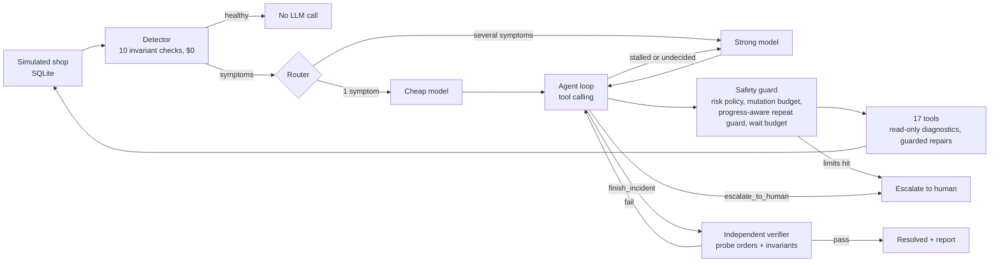

# AutoHeal: evidence-driven incident recovery agent

**HUMAIN Hackathon · Challenge 1: Agentic Recovery of a Failing System**

AutoHeal watches a simulated e-commerce backend, detects broken invariants with deterministic checks, investigates
logs, metrics, config history and data through tools, fixes the **root cause** rather than the symptom, **proves**
the fix with independent probe traffic, and **escalates to a human** with evidence when no safe fix exists.

It is a hackathon prototype running against a SQLite simulator, not a production deployment.

## Two ways to explore AutoHeal

| | **Operations Console** | **Evaluation & Evidence** |
|---|---|---|
| Purpose | Observe, investigate, recover, verify | Compare, examine, validate, understand |
| What it shows | The simulated system now: incidents, live agent activity, approvals | Recorded benchmark results, recorded runs, methodology, limitations |
| How to open it | `streamlit run app.py`, see [Quick start](#quick-start) | Static website in [`evidence-site/`](evidence-site/), see [Evaluation & Evidence site](#evaluation--evidence-site) |
| Needs | Python; an OpenRouter key only for the AI Agent | A browser. No Python, no key |

## The problem

Silent failures are the expensive ones: payments that time out without an error, queues that drop messages under
load, sync jobs that slowly corrupt data, workflows that hang forever. The challenge also warns about the opposite
failure, a repair agent that never stops trying and never escalates. AutoHeal is designed around both: act when the
evidence supports a safe fix, hand off cleanly when it does not.

| Challenge item | Scenario | What AutoHeal does |
|---|---|---|
| Payments silently drop orders | `payment_timeout` | Finds the deploy that cut the gateway timeout below latency, rolls it back, retries stuck payments |
| Queue loses messages under load | `queue_capacity` | Finds the queue shrink, rolls it back, replays dead letters |
| Sync job slowly corrupts data | `sync_corruption` | Reconciliation shows drift, rolls back the mapping change, runs a full resync |
| Workflow hangs forever | `workflow_hang` | Finds the lock holder with a stale heartbeat and terminates it under a guard |
| Repair agent that never escalates | `gateway_outage` | Upstream 503s, so no safe fix exists: escalates with a summary instead of looping |
| Two failures at once | `combo_payment_queue` | Two overlapping deploys plus a knock-on failure that verification catches |
| Control | `healthy` | No LLM call, $0 |

## How it works



**Design principles**
1. **Deterministic first, LLM second.** Detection and verification are plain code, so a healthy system costs $0.
2. **Never trust the agent's claim.** `finish_incident` always triggers independent verification with probe orders.
3. **Least privilege.** The SQL tool is read-only, enforced by SQLite's authorizer rather than a regex, and hides
   internal tables (`sim_faults`, `incidents`, `agent_steps`, `approvals`). Config writes are range-validated.
   Destructive actions need human approval.
4. **Bounded autonomy.** Step limit, mutation budget, progress-aware repeat guard, wait-tick budget, verify-attempt
   limit, per-incident and global USD caps. Every limit ends in an escalation, never a silent stop.
5. **Pay for intelligence where it pays.** Single-symptom incidents start on a cheap model. Multi-symptom incidents,
   failed verification, stalled recovery or a long undecided investigation move to a strong model.

The rule-based **playbook** baseline speaks the same tool-calling protocol and goes through the same tools, safety
guard and verifier, so the two are compared under identical constraints.

## Safety design

| Risk | Tools | Policy |
|---|---|---|
| none | health report, logs, metrics, config, config history, read-only SQL, workflows, wait | always allowed (waiting is bounded per incident) |
| low | `rollback_config`, `replay_dead_letter`, `resync_customers` | automatic |
| medium | `set_config` (range-validated), `retry_stuck_payments`, `terminate_workflow` (stale heartbeat only) | automatic at the default threshold |
| high | `purge_dead_letter` | **never automatic**: filed under Human approvals in the console's Safety & Audit page |

Further safeguards:
- **Payment safety.** `retry_stuck_payments` never re-charges an order that already has a payment record. If every
  stuck order is already paid, the tool refuses and changes nothing.
- **Progress-aware repeat guard.** An identical repair may repeat only while it makes measurable progress, so batched
  recovery works and no-progress loops are blocked.
- **Stagnation control.** After a change, three turns without measurable progress earn a factual reminder; before any
  change, six investigation turns earn one decision prompt. Neither ever acts on the agent's behalf.

## Evaluation results

The full methodology, per-case tables and limitations are in [docs/FINAL_EVALUATION_v321.md](docs/FINAL_EVALUATION_v321.md).
Every evidence file, including earlier baselines and failed runs, is listed in
[docs/EVALUATION_INDEX.md](docs/EVALUATION_INDEX.md).

| Suite | Evidence type | AutoHeal agent | Rule-based playbook |
|---|---|---|---|
| **A**: U1-U5, 12 runs | development/regression (the agent was improved after seeing these cases) | 12/12 | 8/12 |
| **B**: P01-P10, 20 runs | prospective (designed after the version was frozen, by the same team) | 18/20 correct outcomes (90%) | 12/20 (60%) |

How to read these numbers:
- Suite B's 90% counts **correct outcomes** (recovery, correct escalation, or correctly doing nothing). It is not a
  full-recovery rate.
- The agent's entire Suite B lead comes from **P04, P05 and P07**, cases that need evidence-based escalation, partial
  recovery plus escalation, or telling a legitimate change apart from the fault. They were declared in advance as
  favouring the agent. On the neutral and playbook-favouring cases both systems tied, and the playbook was faster and
  free. Both systems missed an intermittent backlog (P02).
- Samples are small (2 seeds per case; confidence intervals overlap). **The results do not establish that the agent is
  generally better than the playbook.** They show where it adds value: judgement and evidence-based escalation.
- No run in either suite executed an unsafe action. Real API cost for both suites: $1.51.
- **Erratum:** in the final report's Suite A table, the historical v3.1 total should read **5/12** for both systems,
  not 7/12. The report is kept byte-identical; the correction is in
  [docs/EVALUATION_NOTES.md](docs/EVALUATION_NOTES.md).
- The [Evaluation & Evidence site](#evaluation--evidence-site) shows these committed results read-only, with the two
  groups kept separate and every recorded run open to inspection.

## Tech stack

Python 3.10+, SQLite, [OpenRouter](https://openrouter.ai) through `requests` (no SDK), Pydantic, python-dotenv,
Streamlit, pandas, pytest. No cloud services and no GPU.

| Role | Default model | Typical cost |
|---|---|---|
| Cheap (single symptom) | `google/gemini-3.8-flash` | about $0.01-0.03 per incident |
| Strong (multi-fault, fallback) | `anthropic/claude-sonnet-5.5` | about $0.05-0.12 per incident |

Every response's real cost (OpenRouter's `usage.cost`) is written to `data/usage.db`, which scenarios never reset.
The client retries on HTTP 429/5xx; hitting a global or per-incident cap ends the incident in an escalation.

## Quick start

Commands are for Windows PowerShell; on macOS/Linux use `source .venv/bin/activate` and `cp` instead of `copy`.

```powershell
python -m venv .venv
.venv\Scripts\activate
pip install -r requirements.txt
```

**1. Offline tests (no key, no network, $0)**
```powershell
pytest
```
Expected: `406 passed, 29 skipped`. This covers the simulator, tools, guards, verifier, budget logic, agent loop,
evaluation harnesses, the console, the evidence site's data and the integrity of the included final evidence. The 29 skipped checks need historical result
files or the original Git history, which are kept in the private development repository; each skip
prints its reason, and [docs/VERIFICATION.md](docs/VERIFICATION.md) lists them.

**2. Offline demos with the rule-based playbook ($0)**
```powershell
python -m autoheal.cli scenarios
python -m autoheal.cli demo payment_timeout --llm playbook
python -m autoheal.cli demo gateway_outage --llm playbook
```
Expected: the first ends **RESOLVED** with verification passed; the outage ends **ESCALATED** with no changes made.

**3. Operations Console**
```powershell
streamlit run app.py
```
- **Operations:** choose a scenario and a recovery engine, click **Inject Fault**, then **Start Recovery**, and follow the
  lifecycle and Agent Activity as events arrive. Open any event for its tool, arguments and result. **Reset** returns to
  the clean, healthy state. The Rule-based Playbook works without a key.
- **System Insights:** health checks, metrics, queue conditions, logs and configuration history. It updates by itself
  while a recovery runs.
- **Safety & Audit:** human approvals, guardrails, the action record and Session Usage. **Advanced settings** holds the
  automatic risk limit and dry-run mode. To see an approval request, set the limit to Low only and run the payment
  scenario.

**4. With the LLM agent (needs an OpenRouter key; costs a few cents per incident)**
```powershell
copy .env.example .env      # then paste your OPENROUTER_API_KEY into .env
python -m autoheal.cli models
python -m autoheal.cli demo combo_payment_queue --llm openrouter
python -m autoheal.cli budget
```
`models` checks that both model IDs exist and support tool calling. `budget` shows actual spend.

## Evaluation & Evidence site

A read-only static website for the recorded results, in three views: an overview with the key results and limitations, a
comparison of the AI Agent and the Rule-based Playbook, and the outcome and key steps of every recorded run. Complete traces
are in the result files it links to. It runs no model, recovery or benchmark.

Live at <https://remas444.github.io/AutoHeal/>.

**Preview locally.** Open `evidence-site/index.html` in a browser, or serve it:
```powershell
python -m http.server 8000 --directory evidence-site
```
then open <http://localhost:8000/>.

**Publish.** With **Source** set to **GitHub Actions** in the repository's **Settings > Pages**,
[`.github/workflows/deploy-evidence-site.yml`](.github/workflows/deploy-evidence-site.yml) publishes `evidence-site/`, and
nothing else, on each push to `main` that changes the site or results. It can also be started from the **Actions** tab.
GitHub Pages on a private repository needs a paid GitHub plan, and the site's document links only work for visitors if the
repository is public.

**Where the data comes from.** `evidence-site/data/evidence.js` is generated from the two files in `data/eval/`, which are
only read. Each original record is embedded unchanged, and display names are added alongside the original scenario
identifiers and seeds.
```powershell
python -m autoheal_ui.evidence_export           # regenerate
python -m autoheal_ui.evidence_export --check   # confirm it matches the committed results
```

## Reproducing the evaluation

The exact commands, budgets and caps are pre-registered in [docs/EVALUATION_PLAN_v321.md](docs/EVALUATION_PLAN_v321.md):

```powershell
$env:AUTOHEAL_MAX_TOTAL_USD='10'; python -m autoheal.unseen --agents playbook openrouter --budget 1.25
$env:AUTOHEAL_MAX_TOTAL_USD='10'; python -m autoheal.prospective --agents playbook openrouter --budget 2.25
```

LLM runs are not deterministic, so a rerun produces new evidence rather than reproducing the recorded numbers exactly.
The playbook runs offline and is deterministic. The evaluated system is commit `b999d37` (tag `v3.2.1`) and the
recorded results are commit `b441b41` (tag `eval-final`), both in the private development repository. The production
code in this snapshot is byte-identical to the evaluated version; checksums are in
[docs/VERIFICATION.md](docs/VERIFICATION.md). When run from this snapshot, the Suite B harness cannot confirm the freeze
against Git and records `production_identical_to_freeze: false` in its report.

## Project layout

```
app.py                      Streamlit console entry point
app_pages/                  Operations, System Insights, Safety & Audit
autoheal_ui/                Console logic and evidence export (reads from autoheal; never imported by it)
.streamlit/config.toml      Console theme
evidence-site/              Evaluation & Evidence website (static HTML, CSS, JavaScript and generated data)
.github/workflows/          Publishes evidence-site/ to GitHub Pages
autoheal/
  config.py                 Settings from .env (Pydantic)
  db.py                     SQLite schema: system DB plus a separate usage ledger
  simulator.py              The shop: orders -> payments -> queue -> worker, sync job, workflows
  scenarios.py              The 7 benchmark scenarios and hidden ground truth (evaluation only)
  detector.py               Invariant checks (symptoms only, no LLM)
  tools.py                  17 tools: diagnostics, guarded repairs, finish and escalate
  safety.py                 Risk policy, budgets, progress-aware repeat guard, approvals
  verifier.py               Independent verification with probe orders
  llm.py                    OpenRouter client, usage ledger, budget caps, retries
  agent.py                  Agent loop, routing, reminders, incident report
  playbook.py               Rule-based baseline (offline, $0)
  runtime.py, cli.py        Wiring helpers and command line
  evaluate.py               7-scenario benchmark harness
  holdout.py                H1/H3/H4 stress-test harness
  unseen.py                 Suite A (U1-U5) harness and scoring
  prospective.py            Suite B (P01-P10) harness and scoring
tests/                      Offline tests (29 skip in this snapshot, see docs/VERIFICATION.md)
docs/                       Evaluation report, plan, index, notes and verification
data/eval/                  The two final evaluation results (hash-pinned)
```

## Limitations

- **Simulated environment.** The backend, faults and ground-truth oracles are hand-built; results do not transfer to
  arbitrary production systems.
- **Small samples and designer bias.** Evaluation cases were written by the same team that built the agent, and some
  thresholds (the decision point and queue-age check) were tuned with earlier cases in view. See
  [docs/EVALUATION_NOTES.md](docs/EVALUATION_NOTES.md).
- **Detector coverage.** Intermittent, non-monotonic backlog growth is not detected.
- **Latency and cost.** The agent takes about 30-170 seconds per incident and costs a few cents; the playbook is
  instant and free where its rules apply.
- **Tooling.** There is no tool to reconcile orders that already have a payment, so those cases correctly end in
  escalation.

## Troubleshooting

- **`OPENROUTER_API_KEY is not set`**: create `.env` from `.env.example`.
- **HTTP 400 or model not found**: run `python -m autoheal.cli models --suggest` and change the model in `.env`.
- **HTTP 402**: the OpenRouter key's own credit limit is exhausted; raise it on OpenRouter.
- **Emojis look wrong in the terminal**: use Windows Terminal or VS Code's terminal; the CLI forces UTF-8 output.
- **Start fresh**: delete `data/autoheal.db` and keep `data/usage.db` so your spend history stays.
